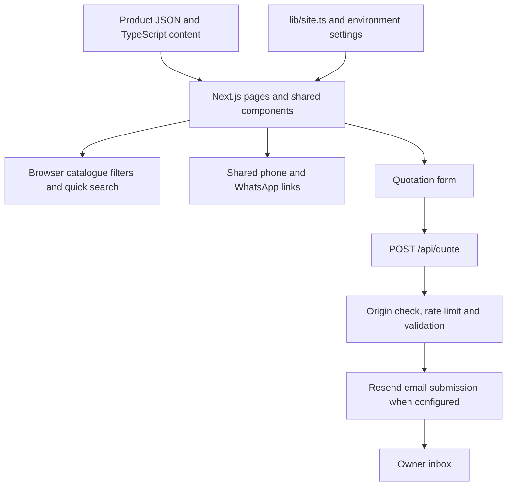

# SSE developer guide

Use this guide to locate the implementation and make changes without relying on the original development conversation. Start with the [README](../README.md) for installation and current release status; use the [operations handover](OPERATIONS.md) for production work.

## Product scope

SSE serves buyers of hydraulic spools, seal kits and other machinery spares. The primary journey is to find a compatible part, read specifications, and request a price or fitment confirmation. Business content targets Indian buyers and dispatch from Faridabad.

The repository contains the catalogue and editorial content. There is no CMS, database, login system, admin dashboard, shopping cart, payment integration, stock synchronization or quote history. A quote request does not calculate a price or generate a quotation PDF; the owner responds separately.

## Architecture

App Router pages compose shared React components. Interactive components declare `"use client"`; most page composition remains on the server. Product detail routes generate static parameters from the catalogue and set `dynamicParams = false`, so new products require a build. Catalogue and quote pages read query parameters through Next.js's asynchronous `searchParams` interface.

The complete catalogue is small enough to filter in the browser. Product JSON is imported into the application, not fetched from an external service. Search and contact behavior are shared through `lib/` to avoid inconsistent results or destinations.

## Repository map

| Location | Responsibility |
| --- | --- |
| `app/layout.tsx` | Archivo font, site metadata, header, footer, floating WhatsApp button and organization JSON-LD |
| `app/page.tsx` | Homepage section composition |
| `app/globals.css` | Global styles, component classes, animation and reduced-motion rules |
| `app/api/quote/route.ts` | Server-side quotation validation and email submission |
| `components/layout/` | Navigation, mobile menu, quick search, footer and floating contact button |
| `components/home/` | Hero, product range, featured products, spool finder, quality and supply coverage |
| `components/products/` | Catalogue, product cards, details, image gallery and descriptions |
| `components/quote/QuoteForm.tsx` | Submission state, field errors and success message |
| `components/gallery/GalleryGrid.tsx` | Site gallery and modal image viewer |
| `components/ui/` | Buttons, layout primitives, icons, logo, page headers and structured-data output |
| `data/products.json` | Product records |
| `data/categories.ts` | Category identifiers, descriptions and artwork |
| `data/posts.ts` | Journal articles stored as typed content blocks |
| `data/coverage.ts`, `data/states.ts` | Supply coverage and form state options |
| `lib/site.ts`, `lib/links.ts` | Business identity, environment configuration and contact URLs |
| `lib/products.ts`, `lib/filters.ts` | Product types, lookup, featured/related products and filtering |
| `lib/product-content.ts`, `lib/format.ts` | Specification rows, explanatory content and display formatting |
| `lib/validation.ts`, `lib/quote-email.ts`, `lib/rate-limit.ts` | Quote input rules, email formatting and request throttling |
| `lib/seo.ts`, `lib/schema.ts` | Canonical URLs, social metadata and structured data |
| `public/` | URL-addressed product/category images, icons and social preview |
| `assets/images/` | Imported hero, site and branding images |
| `next.config.ts` | Image settings and security headers |
| `tailwind.config.ts` | Design tokens and Tailwind scanning paths |

`catalog-image-review/` is an ignored local workspace for extracted originals and image drafts. It is not part of a fresh clone or a production dependency. Published images must exist in tracked asset directories.

## Routes and visitor behavior

| Route | Behavior |
| --- | --- |
| `/` | Homepage, featured parts, machine/year/valve spool finder and supply coverage |
| `/products` | Catalogue with category, machine, valve and text filters |
| `/products/[slug]` | Product images, specifications, explanation, enquiry actions and related parts |
| `/about` | Business background and part imagery |
| `/gallery` | Machinery gallery with modal navigation |
| `/blog`, `/blog/[slug]` | Journal listing and articles |
| `/quote` | General enquiry form |
| `/quote?product=<slug>` | Prefills the selected product, machine and part number |
| `/contact` | Phone, WhatsApp, email, location and business hours |
| `POST /api/quote` | JSON quotation submission endpoint |
| `/sitemap.xml`, `/robots.txt` | Generated discovery metadata; robots excludes `/api/` |

Catalogue query keys are `category`, `machine`, `valve`, `year` and `q`. Example: `/products?machine=JCB&valve=Husco&year=2006&q=loader`. The spool finder submits a normal GET form to this route. Catalogue changes use `history.replaceState`, so the current filters can be shared without adding a history entry for every selection.

`lib/filters.ts` validates known category, machine and valve options on initial load. Text search requires every word to match somewhere across the name, part number, machine, model, valve block, spool position, category or description. Matching is case-insensitive and normalizes dashes. A year filter excludes records with an unknown start year; a `null` end year means onwards.

Header quick search uses the same matching helper, shows up to six results, and opens with `/` or Cmd/Ctrl+K. Arrow keys select results; Enter opens the selected result when present. The full-results action opens the filtered catalogue.

## Product data and images

The `Product` type in `lib/products.ts` is the field reference. JSON is cast to that type rather than runtime-validated, so review additions carefully.

| Fields | Meaning and editing rules |
| --- | --- |
| `id`, `slug` | Unique numeric identifier and stable URL slug; preserve existing slugs or provide redirects |
| `name`, `description` | Display name and short description used across cards, pages and metadata |
| `category` | Must match a slug in `data/categories.ts` |
| `part_number`, `machine`, `model` | Identification and fitment; multiple machine brands use `/` separators. Leave `part_number` empty until confirmed; display copy falls back to enquiry wording, and structured data omits SKU/MPN |
| `year_from`, `year_to` | Numbers or `null`; unknown start year differs from an open-ended end year |
| `valve_block`, `spool_position` | Fitment fields used by filtering and generated descriptions |
| `pack_size`, `material` | Owner-confirmed supply and material information |
| `images` | Ordered public paths; first image is used on cards and in product metadata |
| `image_labels` | Optional labels matched to images by index |
| `image_note` | Optional clarification rendered below the detail gallery |
| `price`, `in_stock` | Existing string fields; do not infer live pricing or inventory from them |

The 34 records comprise 20 spool valves, 8 seal kits, one hydraulic cylinder listing and one each of hydro clamp seals, hub seals, gear lever sets, slew plunger bolts and stub axles. Homepage copy mentions 70+ variants; this marketing figure is separate from the number of website records and needs owner review when content changes.

Some product views are AI-generated from catalogue references. Preserve `AI-generated` and `Original catalog` labels and notes describing variants, incomplete pictured sets or fitment uncertainty. Do not present generated views as original photographs or proof of dimensions. The gallery creates at least four slots; missing views intentionally display “Photo coming soon.”

The About page's four brand showcase cards resolve their images and labels from each product's current first catalogue image. Update `data/products.json` to change those views; the showcase uses contained images so the entire part remains visible, and retains the catalogue's image disclosure labels.

To add or update a part:

1. Copy a structurally similar record in `data/products.json`, assign a unique ID and slug, and confirm technical facts with the owner.
2. Place final images under `public/images/products/<slug>/`; reference them as `/images/products/<slug>/<filename>` and keep labels aligned with image order.
3. Check `lib/product-content.ts` when adding a new category or spool position; descriptions depend on these values. Add category content/artwork and machine or valve options where necessary.
4. Edit `featuredSlugs` in `lib/products.ts` only if the homepage should feature the part. Related products are derived automatically.
5. Check filtering, the detail URL, image captions, quote prefilling and WhatsApp message. Rebuild and deploy so the static route and sitemap include the record.

To add journal content, follow the `Post` type in `data/posts.ts`: unique slug, title, excerpt, date, reading time, category, author and `p`, `h2` or `ul` body blocks. Article routes and sitemap entries are derived from this data.

## Shared contact behavior

`NEXT_PUBLIC_CONTACT_PHONE` feeds `lib/site.ts`. Non-digits are removed to derive the `tel:` and WhatsApp numbers; the code does not infer a country code or validate that the number is registered with WhatsApp. Supply the complete international number.

`lib/links.ts` creates `https://wa.me/<digits>?text=<encoded message>`. Footer links, the floating button, mobile menu and enquiry actions use this helper. Product enquiry messages include the product name and, when available, part number. Change configuration once rather than adding numbers to individual components. Missing configuration currently falls back to an unusable all-zero number; see the incident record in [operations](OPERATIONS.md#whatsapp-fix).

## Quotation request contract

The browser sends JSON to `/api/quote` and displays submitting, success or error state. Name and phone are required; email is optional and validated when supplied. Other fields are company, state, machine, part number, quantity, message and product. The hidden `website` field is a spam honeypot.

The server checks request origin and JSON content type, applies a nominal 8 KiB body limit and a 10-request-per-10-minute IP window, then parses and validates fields. Strings are trimmed, null characters removed and overlong values truncated to the limits in `lib/validation.ts`. The body check uses declared bytes and, after reading, JavaScript string length; it is not a streaming byte cap.

After validation, a filled honeypot receives `{ "ok": true }` without sending email. Normal requests use `buildQuoteEmail` to produce text and escaped HTML. The subject prefers part number, then product, then machine. Resend receives the configured sender and recipient, with the customer's email as `replyTo` when present.

| HTTP status | Current meaning |
| --- | --- |
| `200` | Provider accepted the request, or the honeypot intentionally discarded it; not proof of inbox delivery |
| `400` | Malformed JSON/request body |
| `403` | Origin check rejected the request |
| `413` | Body exceeds the configured size check |
| `415` | Content type is not JSON |
| `422` | Invalid fields; response contains `errors` and `error` |
| `429` | In-memory rate limit exceeded; includes `Retry-After` |
| `503` | `RESEND_API_KEY` is missing |
| `502` | Resend returned a send error |

There is no persistent storage, queue, automatic retry or delivery webhook. A failed send is not saved for the owner. Unexpected thrown provider errors are not explicitly caught in the API route; the frontend has a generic failure handler. The email template says to reply directly even when the optional customer email is absent; in that case the owner must use the supplied phone number. These limitations are listed as follow-up work in operations.

## Styling and metadata

Reuse existing `components/ui/` primitives and shared tokens. The palette is navy/ink with orange accents, light backgrounds and WhatsApp green. Archivo is loaded through `next/font/google`; condensed display headings use its width axis. Responsive layouts and reduced-motion behavior live in component classes and `app/globals.css`.

Metadata derives from `site.url`, `lib/seo.ts` and `lib/schema.ts`. `JsonLd` escapes `<` before embedding JSON. Product schema describes parts but does not publish price offers. Changing the public domain requires updating `NEXT_PUBLIC_SITE_URL` and rebuilding; changing only Vercel's domain alias does not update canonical URLs or sitemap links.

Security headers in `next.config.ts` restrict scripts, connections, frames and form actions. Production enables HSTS and HTTPS upgrading; development allows `unsafe-eval` and avoids upgrading localhost to HTTPS. If introducing a browser-side service such as FormSubmit, review the relevant CSP directives as part of that integration instead of disabling the policy globally.

## Cylinder and ram seal additions

On 28 November 2026, two owner-supplied photos were added as `slew-and-hydraulic-cylinders` (Hydraulic Cylinders category) and `ram-cylinder-seals` (Seal Kits, `Ram cylinder` position). Each gallery begins with the unmodified supplied photograph and includes three labelled generated views. Final assets are in the corresponding `public/images/products/<slug>/` directories; the built-in image generation prompts are recorded in [catalog-image-prompts.json](catalog-image-prompts.json).

These are general enquiry listings. No specific machine brand, part number, seal size, material or pack quantity has been confirmed. They appear in the unfiltered catalogue and text/category search, but do not claim a match when a specific brand or model year is selected. Their descriptions request cylinder/seal measurements rather than inheriting valve-block or spool instructions.

Run `node tests/catalog.cjs` after changing these records or shared description/link helpers. The check verifies assets, labels, search visibility, enquiry behavior without a part number, and preservation of identifiers for existing products.
